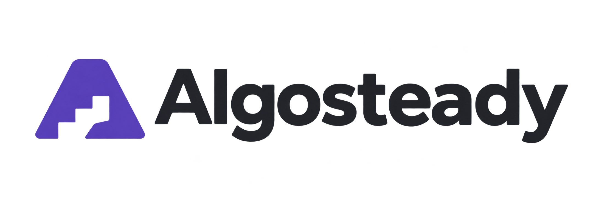

# Algosteady



자료구조·알고리즘의 핵심 구현을 학습하고, 직접 반복해서 작성하며 익히는 웹 서비스다.

개념 설명·시각화·기준 코드로 학습한 뒤, 실습에서 코드를 작성하고 실행·제출해 결과를 확인한다. 오늘의 학습과 완료 기록으로 꾸준한 학습을 이어간다.

## 주요 기능

| 기능 | 내용 |
| --- | --- |
| 학습 목록 | 분류·이름 검색과 페이지네이션 |
| 학습하기 | 개념 설명·단계별 시각화·기준 코드 확인 |
| 실습하기 | Monaco 편집기에서 코드 작성, 브라우저 초안 저장 |
| 실행·제출 | 예제 실행, 전체 테스트 채점, 오류·출력·실행 시간·기준별 판정 확인 |
| 오늘의 학습 | 매일 공통 학습 배정, 진행·완료 상태 표시 |
| 개인 기록 | 제출 코드·채점 결과 조회, 연속·누적 완료 일수와 연도별 잔디 |
| 로그인·탈퇴 | Google OAuth 로그인, 회원탈퇴와 본인 기록 삭제 |

학습과 예제 실행은 로그인 없이 이용할 수 있다. 제출과 개인 기록은 로그인 후 이용한다.

학습 항목은 재귀·스택·큐부터 그래프·문자열·문제 해결 기법까지 구성하며, 전체 분류는 [학습 목록](docs/curriculum.md)에서 확인한다.

## 기술 스택

| 영역 | 기술 |
| --- | --- |
| 프론트엔드 | React, TypeScript, Vite, Monaco Editor |
| 백엔드 | Java 21, Spring Boot, Spring Security, OAuth 2.0, Spring Data JPA |
| 데이터베이스 | PostgreSQL 18, Flyway |
| 실습 언어 | C17, Python |
| 코드 실행 | Docker |

## 로컬 실행

Node.js 24, JDK 21, Docker를 준비한다. 아래 명령은 저장소 루트에서 시작한다.

**1. 환경변수·DB·실행 이미지 준비**

`.env`가 없으면 `.env.example`을 복사하고 DB·OAuth 값을 설정한다.

| 환경변수 | 설정 |
| --- | --- |
| `POSTGRES_DB`, `POSTGRES_USER`, `POSTGRES_PASSWORD` | 로컬 PostgreSQL 접속 정보 |
| `GOOGLE_CLIENT_ID`, `GOOGLE_CLIENT_SECRET` | Google OAuth 웹 애플리케이션 클라이언트 자격 증명 |
| `FRONTEND_URL` | 웹 화면 주소. 로컬 기본값은 `http://localhost:5173` |

Google Console의 승인된 리디렉션 URI에 `http://localhost:5173/login/oauth2/code/google`을 등록한다([Google 설정 안내](https://developers.google.com/identity/protocols/oauth2/web-server#creatingcred)). 주소를 바꾸면 `FRONTEND_URL`과 등록된 리디렉션 URI를 함께 맞춘다.

```bash
cp .env.example .env
# .env 수정 후 실행
docker compose up -d postgres
docker build -t algosteady-runner-c:14.4.0 runners/c
```

**2. 백엔드 실행**

```bash
set -a
source .env
set +a
cd backend
SPRING_PROFILES_ACTIVE=dev ./mvnw spring-boot:run
```

**3. 프론트엔드 실행 — 별도 터미널**

```bash
cd frontend
npm ci
npm run dev
```

| 대상 | 주소 |
| --- | --- |
| 웹 화면 | http://localhost:5173 |
| API 서버 | http://localhost:9090 |
| PostgreSQL | localhost:5432 |

## 빌드·검증

로컬 실행 환경을 준비한 뒤 각 명령 블록을 저장소 루트에서 실행한다. 백엔드 테스트에는 PostgreSQL이, Docker 테스트에는 실행 이미지도 필요하다.

```bash
cd frontend
npm run build
npm run lint
npm test
```

```bash
set -a
source .env
set +a
cd backend
export SPRING_PROFILES_ACTIVE=dev
./mvnw test
./mvnw -Dalgosteady.postgres.tests=true test
./mvnw '-Dtest=CodeExecutionDockerTests,ExerciseContentDockerTests' -Dalgosteady.docker.tests=true test
./mvnw -DskipTests package
```

## 개발 계획

| 목표 기간 | 개발 항목 | 목표 |
| --- | --- | --- |
| 2026-10-12 ~ 10-14 | 프로젝트 초기 구성·설계 | React·Spring Boot·DB 구성, 실습·실행·저장 구조 설계 |
| 2026-10-15 ~ 10-19 | 핵심 학습 흐름 | 학습 코드 조회, 코드 작성, Docker 실행·전체 채점, 제출 기록 연결 |
| 2026-10-20 ~ 10-23 | 실습 화면·편집기 개선 | 실행 시간 표시, Monaco 문법 강조·들여쓰기 및 브라우저 초안 저장 연결 |
| 2026-10-21 ~ 10-25 | 실습 확대 | [학습 목록](docs/curriculum.md)의 C17 콘텐츠 56개 구현 |
| 2026-10-25 | 오늘의 학습 | 로그인 없이 오전 6시 기준 공통 학습 추천과 학습·실습 이동 제공 |
| 2026-10-25 | 홈 개편 | 오늘의 학습 카드, 분류·이름 검색, 페이지당 9개 카드와 페이지네이션 |
| 2026-10-26 ~ 10-30 | Google 로그인·개인 기록 | OAuth 로그인, 비회원 예제 실행과 회원별 제출·채점 결과 조회 |
| 2026-11-07 ~ 11-12 | 마이페이지 | 학습 현황, 잔디형 완료 기록, 날짜별 제출 기록 연결 |
| 2026-11-13 ~ 11-15 | 회원탈퇴 | 마이페이지 하단 탈퇴 버튼, 데이터 처리 안내·최종 확인 |
| 2026-11-10 ~ 11-15 | 서버 배포 | 서버·PostgreSQL 배포, 도메인·HTTPS·운영 환경변수·OAuth 연결 |
| 2026-11-16 ~ 11-20 | CI/CD | 빌드·테스트·배포 자동화 구성 |
| 2026-11-21 ~ 12-13 | Python 지원 | Python 실행 이미지와 실습 코드·테스트 연결 |

## 개발 이력

| 날짜 | 내용 |
| --- | --- |
| 2026-10-12 | 프로젝트 생성 및 프론트엔드 초기 구성 |
| 2026-10-14 | 프로젝트 설계·개발 계획 문서 작성 |
| 2026-10-19 | 실습 콘텐츠 조회, Docker 실행부, 공개 예시 실행·전체 채점, 제출 기록 연결 |
| 2026-10-21 | 재귀·스택·큐·덱·연결 리스트 콘텐츠 추가, Monaco 적용 및 학습·채점 화면 개선 |
| 2026-10-22 | 트리·힙·해싱·유니온 파인드·이진 탐색 콘텐츠 추가, 시각화 분리 및 콘텐츠·실행 검증 보강 |
| 2026-10-23 | 코드 스타일·주석 정리 |
| 2026-10-25 | 정렬·그래프·문자열·문제 해결 기법 콘텐츠와 시각화 추가, 학습 항목 56개 완료 |
| 2026-10-25 | 실행 예제 번호 표시, 실행·제출 결과의 독립 조회·복구 및 오류 처리 개선 |
| 2026-10-25 | Google 로그인·오늘의 학습·홈 개편·마이페이지·회원탈퇴 요구사항 추가, 지원 언어 확대·배포 일정 재설정 |
| 2026-10-25 | 홈 개편: 오전 6시 기준 공통 학습 추천, 분류·이름 검색, 9개 카드 페이지네이션과 URL 상태 복원 구현 |
| 2026-10-25 | 학습 분류 이름·표시 순서·소속 관계를 DB와 조회 API로 관리하고 상세 페이지의 분류 이동 연결 |
| 2026-10-28 | 분류·실습 콘텐츠·화면 코드의 관리 기준과 향후 관리자 콘텐츠 편집·버전 발행 방향 정리 |
| 2026-10-28 | OAuth 로그인·회원 자동 등록, 로그인 상태별 헤더·기본 회원 화면, 세션 로그아웃 및 CSRF 처리 구현 |
| 2026-10-29 | 비회원 예제 실행 유지, 제출·기록 로그인 제한, 회원별 제출·채점 결과 조회 및 브라우저 결과 복구 구분 |
| 2026-10-29 | 서버 기준 일일 학습 배정, 제출 접수 시각 기준의 회원별 완료 저장·조회, 홈 완료 표시 구현 |
| 2026-11-05 | 마이페이지 오늘 완료·연속·누적 현황, 연도별 잔디와 최초 통과 제출 상세 연결 구현 |
| 2026-11-06 | 회원탈퇴·본인 기록 삭제·세션 만료, 오늘의 학습 진행 상태 및 통과 문구 정리 |

## 문서

| 문서 | 내용 |
| --- | --- |
| [학습 목록](docs/curriculum.md) | 자료구조·알고리즘 분류, 기준 구현, 진행 상태 |
| [API](docs/api.md) | 엔드포인트, 요청·응답, 오류 |
| [아키텍처](docs/architecture.md) | 시스템 구성, 모듈 역할, 실행 환경 |
| [콘텐츠 규격](docs/content.md) | 실습 추가 절차, 파일 구성, 테스트·버전 관리 |
